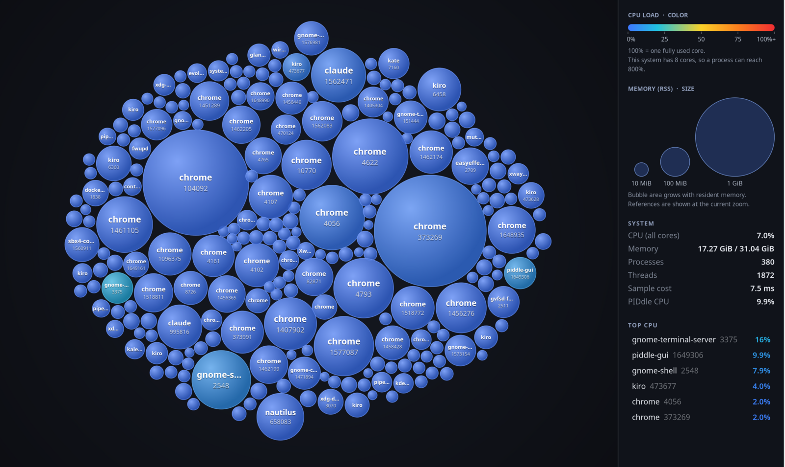
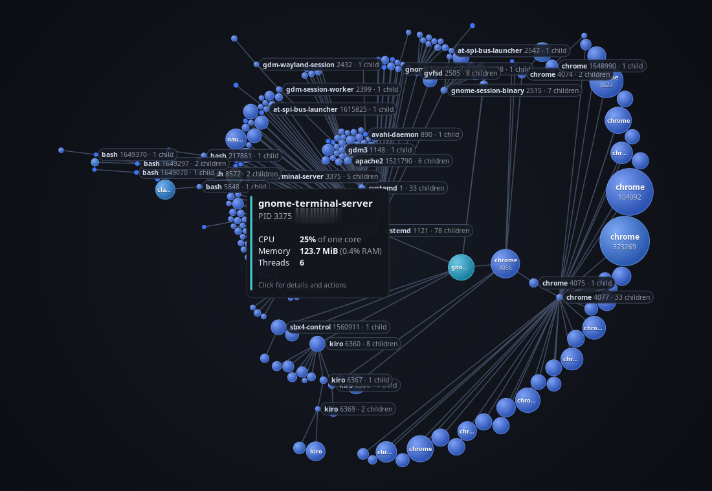
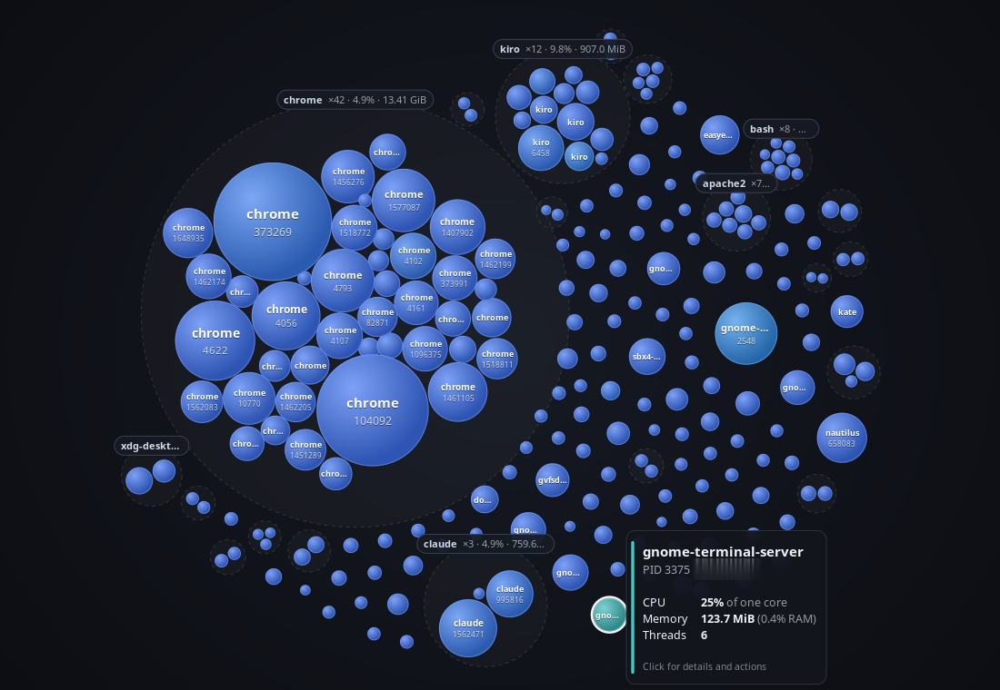
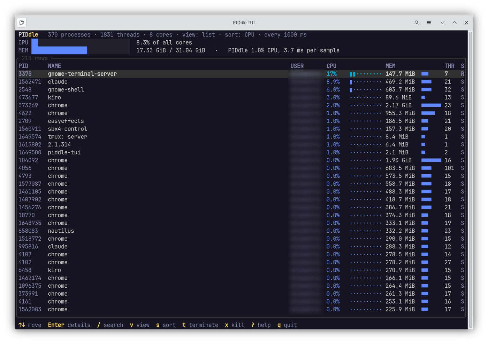
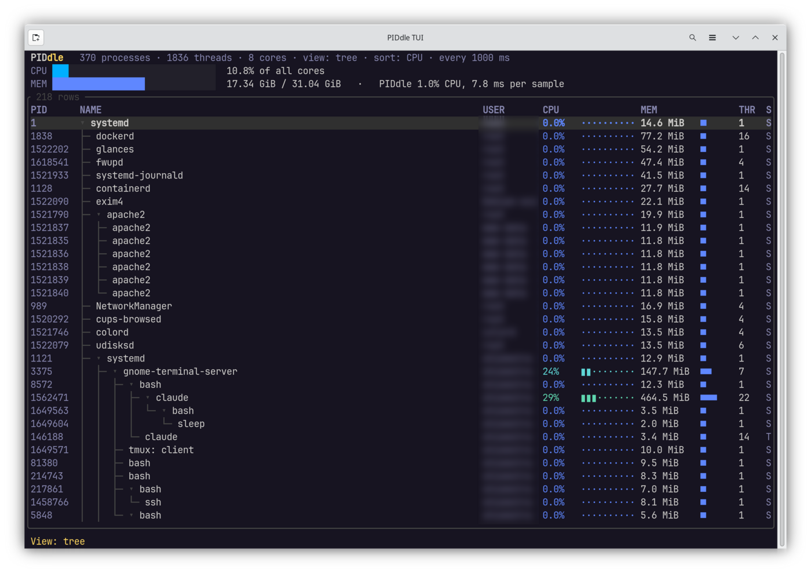
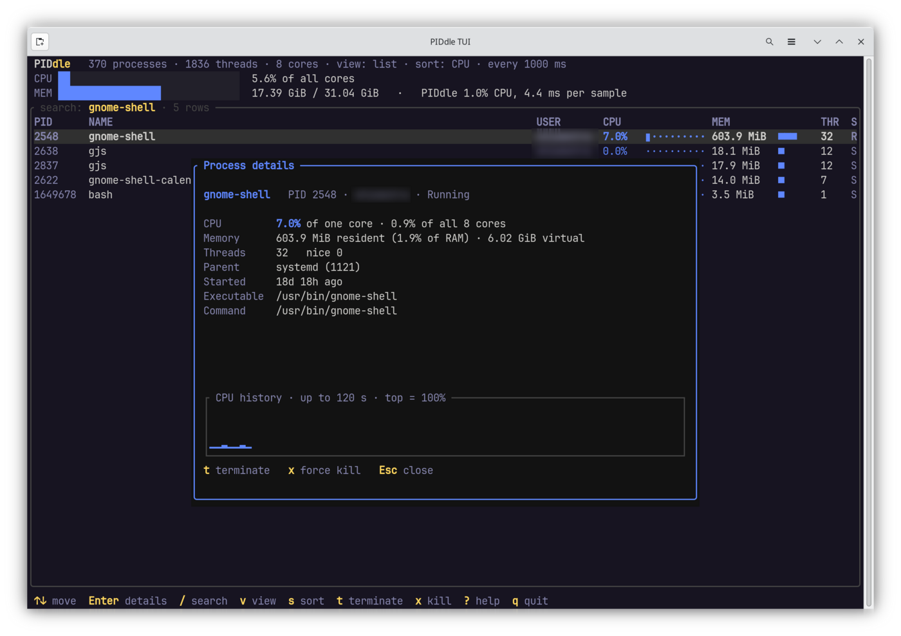

# PIDdle

[](https://github.com/scott-hiemstra/piddle/actions/workflows/ci.yml)

A visual process viewer for Linux (x86_64 and ARM64), written in Rust. It has a GTK 4 graphical interface for the desktop and a terminal interface for servers and SSH sessions.

In the graphical interface, each running process is a bubble:

- **Size is memory.** Bubble area grows with resident memory (RSS).
- **Color is CPU load.** Colors run from cool blue through yellow to hot red. **100% means one fully used core**, so on an 8-core machine a single process can reach 800%. The color scale saturates at 100%.

The terminal interface uses the same CPU colors in a live, sortable process list.



## Usage

```sh
piddle          # graphical interface if a display is available, otherwise the terminal interface (as root: terminal)
piddle --tui    # terminal interface (e.g. over SSH); options are passed on: piddle --tui --interval 500
piddle --gui    # graphical interface
```

`piddle` is a small launcher that links no GUI libraries. It starts `piddle-gui` when a display is available, and switches to `piddle-tui` when:

- there is no `WAYLAND_DISPLAY` or `DISPLAY`;
- `piddle-gui` isn't installed;
- GTK's libraries are missing;
- or no display can be opened (for example a stale `DISPLAY` in an SSH session).

You can also run `piddle-gui` or `piddle-tui` directly. The app-menu entry starts `piddle-gui`.

## Graphical interface

| Process tree | By application |
|---|---|
|  |  |

Hover a bubble for CPU, memory and thread count. Click it to open the details window, which has the **Terminate** (SIGTERM) and **Force Kill** (SIGKILL) actions. Both are protected against mistakes (see [Safety](#safety-when-stopping-processes)).

- Real data sampled from `/proc` every 250 ms, 500 ms, 1 s or 2 s (configurable), with a pause button.
- Smooth animation: sizes, colors, fade-in and fade-out ease between samples. A damped, position-based simulation keeps existing bubbles where they are and only nudges neighbours.
- Four layouts:
  - **Free**: one packed cloud.
  - **By application**: processes clustered by executable, for example all `chrome` processes. Each cluster shows its count, total CPU and total memory.
  - **By parent**: processes clustered by parent PID.
  - **Process tree**: a radial tree with the root in the center and one ring per generation. Parent→child links are drawn, and siblings are ordered by PID so the tree doesn't reshuffle. Every parent process gets a tag with its name, PID and child count, even when its bubble is tiny.
- Search by name, command line or PID prefix. Matches are ringed and everything else is dimmed, so the layout doesn't jump around.
- Filters: show or hide kernel threads (hidden by default), and **Active only**, which shows processes that used CPU in the last few seconds.
- Screenshots: the camera button or **Ctrl+S** saves the canvas and sidebar as a full-resolution PNG in `~/Pictures` and copies it to the clipboard. With Ctrl+S, the hover card for the process under the mouse is included.
- Details window with a live 60-second CPU history, CPU / memory / thread / disk I/O cards, parent, user, start time, priority, executable, command line, and the process's network connections (TCP and UDP with addresses and state, plus a Unix socket count).
- Sidebar with a color and size legend. The size references are drawn at the current zoom, so they match the bubbles on screen. Below the legend are system totals, a top-CPU list (click an entry to open its details), and PIDdle's own CPU use and per-sample cost.
- A dark interface that stays dark and readable even when the desktop forces a light GTK color scheme, as KDE's Breeze does. PIDdle also hides the harmless `Unknown key gtk-modules` warning that KDE's GTK4 settings cause.

| Key | Action |
|---|---|
| Ctrl+S | Save a screenshot and copy it to the clipboard |
| Start typing | Search |
| Esc | Clear the search |

## Terminal interface



| Tree view | Search and details |
|---|---|
|  |  |

A live process list with system CPU and memory meters. Each row shows:
- CPU, colored with the GUI's scale, with a bar where full means one core;
- memory, with a relative bar;
- disk reads and writes per second;
- threads and state.

- The same four views: list, by application, by parent, and process tree. Groups and tree branches can be collapsed.
- Search, sorting (CPU, memory, disk I/O, PID, name), active-only and kernel-thread filters, and an adjustable sampling interval.
- A details popup with CPU history, disk I/O totals, and the process's network connections.
- Terminate and Force Kill with the same safety rules as the GUI.
- Uses 24-bit color when the terminal advertises it (`COLORTERM=truecolor`), otherwise the nearest 256-color shades.

| Key | Action |
|---|---|
| ↑ ↓ PgUp PgDn Home End | Move |
| Enter | Details (or collapse a group) |
| Space | Collapse / expand a group or tree branch |
| `/` | Search name, command or PID (Esc clears) |
| `v` or `1`–`4` | View: list, by application, by parent, tree |
| `s` | Sort: CPU, memory, disk I/O, PID, name |
| `i` | Show / hide the disk I/O columns |
| `a` / `K` | Active only / show kernel threads |
| `+` / `-` | Sampling interval |
| `p` | Pause / resume |
| `t` / `x` | Terminate (SIGTERM) / force kill (SIGKILL) |
| `?` | Help |
| `q`, Ctrl+C | Quit |

## Disk I/O and network: what Linux allows

- **Disk I/O** comes from `/proc/<pid>/io`: bytes actually read from and written to storage, the same numbers `iotop` shows. Linux only exposes this file for your own processes, so other users' processes show `–` unless PIDdle runs as root. The terminal UI collects it for every process (one more small read each); the GUI reads it only for the process whose details are open.
- **Network:** Linux has no cheap per-process bandwidth counter. Tools like `nethogs` need root plus packet capture or eBPF. PIDdle instead lists each process's **connections**: its socket inodes from `/proc/<pid>/fd` are matched against the kernel's TCP/UDP tables in the process's own network namespace (so containers show their own addresses). This is done only for the process being viewed, every 2 seconds. Other users' processes need root.

## Safety when stopping processes

- **Blocked:** PID 1 (init) and kernel threads can't be signalled at all.
- **Critical:** for desktop-session and core system processes (`gnome-shell`, `systemd`, `Xwayland`, `dbus`, `sddm`, `NetworkManager`, `pipewire` and so on), PIDdle itself, and any process PIDdle runs inside, you have to type the process name to confirm.
- **Everything else:** a confirmation that defaults to No. It mentions how many child processes there are and suggests Terminate before Force Kill.
- **PID reuse:** before signalling, PIDdle confirms the PID still belongs to the process you picked (same start time).
  - On **Linux 5.3 and newer** this is race-free: the signal goes through a pidfd opened before that check, so if the PID is recycled the signal can't reach the new process.
  - On **older kernels** there are no pidfds. PIDdle checks and then calls `kill(2)`, which leaves a very small window in which the PID could be recycled between the two steps.
- These rules live in `piddle_core::actions::assess`, so both interfaces get them.

You can only signal other users' processes when PIDdle runs with the right privileges. Use `sudo piddle` for that: as root, the launcher starts the terminal interface rather than the GUI, because running a GUI toolkit as root is a needless risk (`--gui` overrides).

## Security

- **Untrusted text is neutralized.** Process names, command lines and executable paths are chosen by whoever starts a process, so they may contain terminal escape sequences, carriage returns or Unicode bidirectional overrides. PIDdle replaces control characters with `�` and drops bidi controls before anything is displayed. A hostile process name can't rewrite your terminal or disguise itself. The GUI also escapes every value it puts into Pango markup.
- **Signals are bound to the process you chose.** On Linux 5.3+, Terminate and Force Kill open a pidfd, verify the process's start time, then signal through the pidfd, so a recycled PID can't receive the signal. Older kernels have no pidfds: there PIDdle verifies the start time and then calls `kill(2)`, which narrows the PID-reuse race to the moment between those two calls but doesn't eliminate it.
- **No root GUI by default**, see above. The launcher and terminal UI are small static binaries with no GUI libraries.
- **Release builds:** every GitHub Action is pinned to a full commit SHA, only the final publish step can write to the repository, and pull requests from forks run with a read-only token. Dependabot proposes updates for actions and crates, and `cargo audit` reports no known vulnerabilities in the dependencies.

## Low overhead

- Each sample does one small read of `/proc/<pid>/stat` per process. Command line, owner and application name are read once per process and cached by (PID, start time), so a reused PID is detected.
- Sampling runs on a background thread. Only the latest snapshot is kept, so the UI never processes a backlog.
- GUI: the canvas draws through GtkSnapshot/GSK render nodes, so the GPU does gradients, clipping, strokes and text rendering. The frame clock stops as soon as nothing visible is changing. While only colors are easing, the canvas redraws at about 20 fps.
- TUI: redraws only when a key is pressed or new data arrives. It uses about 1% of one core at the default 1-second interval, including per-process disk I/O.

## Install

**[Download the latest release](https://github.com/scott-hiemstra/piddle/releases/latest)**: packages for Debian/Ubuntu (`.deb`), Fedora/RHEL/openSUSE (`.rpm`) and Arch Linux, for x86_64 and ARM64.

There are two packages:

| Package | Contains | Dependencies |
|---|---|---|
| `piddle` | `piddle` launcher, `piddle-tui` | none (static binaries); works on any Linux of its architecture |
| `piddle-gui` | `piddle-gui`, app-menu entry | GTK 4.14+, glibc 2.34+, `piddle` |

On a server, download and install `piddle`. On a desktop, install both. Then install the downloaded files:

| Distribution | Install (x86_64 file names; ARM64 uses `arm64` / `aarch64`) |
|---|---|
| Debian, Ubuntu | `sudo apt install ./piddle_0.3.2_amd64.deb ./piddle-gui_0.3.2_amd64.deb` |
| Fedora, RHEL, openSUSE | `sudo dnf install ./piddle-0.3.2-1.x86_64.rpm ./piddle-gui-0.3.2-1.x86_64.rpm` |
| Arch Linux | `sudo pacman -U piddle-0.3.2-1-x86_64.pkg.tar.zst piddle-gui-0.3.2-1-x86_64.pkg.tar.zst` |

Remove with `apt remove`, `dnf remove` or `pacman -R` and the package names.

- **Static terminal binaries:** `piddle` and `piddle-tui` are built for `x86_64-unknown-linux-musl` and `aarch64-unknown-linux-musl`. They have no runtime dependencies, so they run on older servers too (tested on Debian 12 and Ubuntu 22.04, and on ARM64 Debian 12).
- **GUI dependencies:** for `piddle-gui` they come from `dpkg-shlibdeps` and rpmbuild's library scan. The Arch package declares them explicitly.
- **Upgrading from 0.1.0**, where `piddle` was the GUI: the `.deb` and `.rpm` move the app-menu entry to `piddle-gui` cleanly. The RPM also installs `piddle-gui` automatically on upgrade.
- **Tested:**
  - Debian 12 server: `piddle` only, no GTK pulled in.
  - Debian 13 and Fedora 43: upgrade from 0.1.0.
  - Fedora 43: `piddle` only.
  - Arch Linux: both packages, with all libraries resolved.
  - ARM64 Debian 13 and Fedora 43 (emulated): both packages, with all libraries resolved.

### Building the packages yourself

| Distribution | Build | Output |
|---|---|---|
| Debian, Ubuntu | `packaging/build-deb.sh` | `target/debian/` |
| Fedora, RHEL, openSUSE | `packaging/build-rpm.sh` | `target/rpm/` |
| Arch Linux | `packaging/build-arch.sh` | `target/arch/` |

- **Architectures:** the scripts build for the machine they run on. Set `PIDDLE_ARCH=aarch64` (or `x86_64`) together with `PIDDLE_SKIP_BUILD=1` to package binaries built elsewhere; the GUI can't be cross-compiled because it links that architecture's GTK.
- **Building on any distro:** the scripts don't have to run on the target distribution. You need the musl target (`rustup target add x86_64-unknown-linux-musl`). On Debian you also need `rpm` for the RPMs, and `makepkg` plus `pacman-package-manager` for the Arch packages.

### Releases

Pushing a version tag builds all packages on GitHub Actions and attaches them to a GitHub release:

```sh
git tag v0.3.2 && git push origin v0.3.2     # tag must match the version in Cargo.toml
```

The `.deb` and `.rpm` are built on Ubuntu 24.04, natively on GitHub's x86_64 and ARM64 runners. The Arch packages are made from the same binaries in an Arch Linux container. You can also run the **Release** workflow by hand from the Actions tab; it then only builds the packages as downloadable artifacts and publishes nothing.

## Build and run from source

Requirements: Rust (stable, 2024 edition) and GTK ≥ 4.14 development files (`libgtk-4-dev` on Debian/Ubuntu). The terminal interface alone needs no GTK: `cargo build --release -p piddle -p piddle-tui`.

```sh
cargo run --release -p piddle-gui      # graphical interface
cargo run --release -p piddle-tui      # terminal interface
cargo test --workspace                 # unit tests
cargo fmt --all && cargo clippy --workspace --all-targets -- -D warnings   # what CI checks
```

## Project layout

```
crates/
  piddle/           launcher (binary `piddle`); standard library only
  piddle-core/      UI-independent; depends only on libc and async-channel
    sampler.rs      /proc sampling: Sampler (synchronous) or spawn() (background thread)
    encode.rs       CPU → color, memory → radius, formatting helpers
    actions.rs      risk assessment (assess), signalling via pidfd (PID-reuse guard), state names
    net.rs          a process's network connections, from /proc/<pid>/fd and /proc/<pid>/net
    examples/top.rs minimal plain-text example
  piddle-gui/       GTK 4 interface (binary `piddle-gui`)
    view.rs         bubble model, layouts, physics, GSK rendering
    canvas.rs       custom widget that renders the view
    legend.rs       color/size legend
    details.rs      details window, CPU history, confirm / type-to-confirm dialogs
    screenshot.rs   capture the window contents to PNG and clipboard
    main.rs         window, header controls, sidebar, theming, wiring
  piddle-tui/       Ratatui interface (binary `piddle-tui`)
    app.rs          state, views, search, keys, confirm flows
    ui.rs           rendering
    main.rs         arguments and event loop
.github/workflows/  ci.yml (fmt, clippy, test, build; x86_64 + ARM64), release.yml (packages + GitHub release)
data/               desktop entry
docs/screenshots/   README images
packaging/          build-deb.sh, build-rpm.sh, build-arch.sh (+ common.sh)
```

## Developer tools

`piddle-gui --snapshot out.png [free|app|parent|tree] [query]` renders the canvas off-screen to a PNG using live data. It still needs a display connection.

## Contributors

- **Scott Hiemstra** ([scott@hiemstra.us](mailto:scott@hiemstra.us)): author and maintainer; product direction, design and testing
- **Claude** (Anthropic): AI pair programmer; implementation

## License

PIDdle is released under the [MIT License](LICENSE). Copyright © 2026 Scott Hiemstra.
